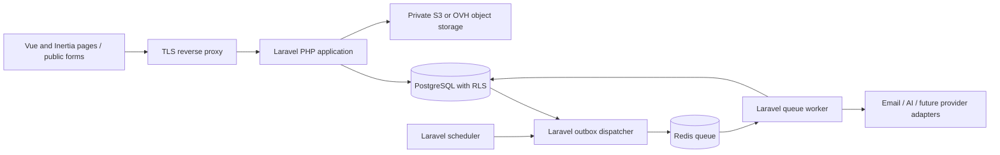

# Architecture

## Approved stack

**Confirmed:** Laravel/PHP modular monolith; Vue 3, TypeScript, and Inertia.js; Tailwind CSS and shadcn-vue; PostgreSQL with tenant RLS; Redis with Laravel queues and scheduler; Docker Compose; GitHub Actions. This replaces the earlier provisional NestJS/React/BullMQ design. Subsequent user instruction authorizes implementation one milestone at a time; see D13 in [decisions](decisions.md).

| Component | Responsibility and design choice |
|---|---|
| Laravel/PHP | Routing, controllers, validation, policies, domain services, Eloquent persistence, notifications, and integration endpoints. Use one application with explicit domain boundaries. |
| Vue 3 + TypeScript | Pipeline board, lead drawers, multi-step forms, dashboards, and approval inbox. Use the Composition API and typed page props. |
| Inertia.js | Connect Vue pages to Laravel routes/controllers using same-origin sessions. The web UI does not require a separate REST frontend or client-side router. |
| Tailwind + shadcn-vue | Shared responsive UI components, styled to the mockup palette; keyboard and accessibility behavior require explicit testing. |
| Vite | Build frontend assets in CI. Initial deployment serves built assets without a permanent Node frontend process. |
| PostgreSQL | Durable system of record, relational integrity, migrations, and RLS. No vector extension until matching has a validated dataset. |
| Redis | Laravel queue transport and rate limits; never authoritative for money, grants, or scheduled business intent. |
| Laravel queues + scheduler | Separate queue worker and scheduler processes from the same application image; named reminder/digest jobs with persisted intent and idempotency. |
| Laravel filesystem | Private object storage abstraction; AWS S3 or OVH Object Storage remains open pending region, cost, and compatibility review. |

No framework versions are pinned during planning. Select maintained compatible releases and lock dependencies only when implementation is authorized. React, Next.js, NestJS, Supabase, Inngest, and BullMQ are not selected application dependencies; references in the source analysis describe historical mockup content.

## Boundaries and request flow

Backend modules: identity/tenancy; creator CRM; onboarding/documents; profiles/media kits; reminders/notifications; billing/entitlements; audit/privacy. Later modules: partnerships/campaigns; attribution; commissions/payouts; PRM/incentives; integrations; AI insights. Controllers stay thin and call domain services shared by web requests, jobs, and later API endpoints.

**Confirmed repository layout (D16):** one Laravel application rooted in `src/`, with domain code under `src/app/`, routes under `src/routes/`, Vue pages/components under `src/resources/js/`, migrations under `src/database/migrations/`, tests under `src/tests/`, and built public assets under `src/public/`. Application dependency manifests, lockfiles, environment configuration, Docker build files, and scripts also live in `src/`. Keep `docs/`, `mockup/`, `planning/`, `README.md`, `AGENTS.md`, `.github/`, and `compose.yaml` at the repository root. Paths inside the application retain normal Laravel conventions; run PHP/Node tooling from `src/`.

Browser requests pass authentication, active-membership validation, policies, Form Request validation, entitlements, and a tenant-bound database transaction. Eloquent scopes help application queries but do not replace RLS. Serialize explicit authorized props/resources; do not expose entire models, hidden relationships, or private fields through globally shared Inertia props. Public forms use restricted capability handlers. REST/OpenAPI supports integrations and selected JSON operations; see [API design](api-design.md).

M1 implementation holds a shared lock on the actor's active membership for each selected-workspace transaction. A narrowly scoped `app_lock_membership` function obtains it without granting runtime membership mutation. Revocation/demotion waits for an already authorized transaction to commit or roll back; if the membership change locks first, a waiting action observes the changed row and is denied. New requests/jobs recheck membership and role. Keep these transactions short. Workspace changes append an audit event only after exactly one authorized row is updated.

Public media-kit metadata and social previews can use Laravel-rendered HTML/Blade where needed. Inertia SSR and its Node runtime are deferred unless a confirmed requirement justifies them. Avoid microservices, Kubernetes, a warehouse, self-hosted AI, and a generic workflow builder at launch.

## Reliable jobs and automation

Persist business changes, audit events, and outbox records in one PostgreSQL transaction. A Laravel dispatcher publishes committed records to Laravel queues with stable event IDs; consumers deduplicate. Dispatch-after-commit avoids processing rolled-back data but does not by itself close the database/queue failure gap; retain the outbox. At-least-once delivery requires idempotent side effects. Store schedules and progress in PostgreSQL so Redis loss can be reconciled.

Begin with named templates: reminder, follow-up draft, onboarding invite, weekly digest. Persist organization, subject, rule version, due time/timezone, consent, and approval state. Jobs carry scalar IDs, establish tenant context before loading models, and clear context between jobs. Recheck current membership/grants, replies, rule state, entitlements, and consent before executing. A logged reply cancels obsolete follow-ups; snooze persists a real future time.

Run the scheduler as a separate process; prevent duplicate dispatches with locking and database constraints. Use bounded retries/backoff, failed-job review, per-tenant quotas, and observable queue age. Laravel notifications/mail deliver messages only after required approval. AI remains an optional consent-based adapter with redacted inputs, budgets, recorded versions/factors, feedback, and a non-AI fallback.

M1 process evidence uses synthetic tasks only: an uncommitted worker write is killed and reclaimed from Redis; a failed scheduled task releases its overlap lock; a killed task retains its lock until the configured test TTL expires. Compose worker/scheduler services use an init process for child reaping and restart automatically after their Artisan process is killed. These checks do not establish exactly-once external actions; durable intent, deduplication, and business schedules remain M5 work.

## Technical references

- [Laravel starter kits](https://laravel.com/docs/13.x/starter-kits): Vue, TypeScript, Inertia, Tailwind, and shadcn-vue baseline.
- [Inertia](https://inertiajs.com/): Laravel-controlled routing with interactive frontend pages.
- [Laravel queues](https://laravel.com/docs/13.x/queues) and [file storage](https://laravel.com/docs/13.x/filesystem): background work and storage abstraction.
- [PostgreSQL RLS](https://www.postgresql.org/docs/current/ddl-rowsecurity.html): policy behavior and bypass considerations.
- [Docker Compose production guidance](https://docs.docker.com/compose/how-tos/production/) and [GitHub image publishing](https://docs.github.com/en/actions/tutorials/publish-packages/publish-docker-images): deployment foundations.
