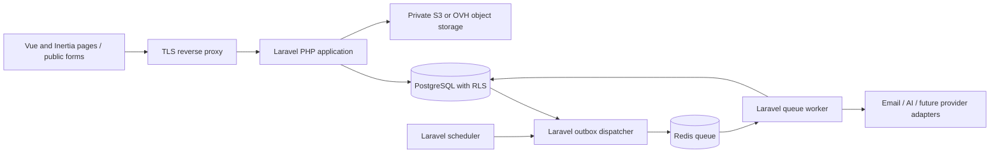

# Architecture

## Approved stack

**Confirmed:** Laravel/PHP modular monolith; Vue 3, TypeScript, and Inertia.js; Tailwind CSS and shadcn-vue; PostgreSQL with tenant RLS; Redis with Laravel queues and scheduler; Docker Compose; GitHub Actions. This replaces the earlier provisional NestJS/React/BullMQ design. Subsequent user instruction authorizes implementation one milestone at a time; see D13 in [decisions](decisions.md).

| Component | Responsibility and design choice |
|---|---|
| Laravel/PHP | Routing, controllers, validation, policies, domain services, Eloquent persistence, notifications, and integration endpoints. Use one application with explicit domain boundaries. |
| Vue 3 + TypeScript | Pipeline board, lead drawers, multi-step forms, dashboards, and approval inbox. Use the Composition API and typed page props. |
| Inertia.js | Connect Vue pages to Laravel routes/controllers using same-origin sessions. The web UI does not require a separate REST frontend or client-side router. |
| Tailwind + shadcn-vue | Shared responsive UI components, styled to the mockup palette; keyboard and accessibility behavior require explicit testing. |
| Vite | Build frontend assets in CI. Initial deployment serves built assets without a permanent Node frontend process. |
| PostgreSQL | Durable system of record, relational integrity, migrations, and RLS. No vector extension until matching has a validated dataset. |
| Redis | Laravel queue transport and rate limits; never authoritative for money, grants, or scheduled business intent. |
| Laravel queues + scheduler | Separate queue worker and scheduler processes from the same application image; named reminder/digest jobs with persisted intent and idempotency. |
| Laravel filesystem | Private object storage abstraction; AWS S3 or OVH Object Storage remains open pending region, cost, and compatibility review. |

No framework versions are pinned during planning. Select maintained compatible releases and lock dependencies only when implementation is authorized. React, Next.js, NestJS, Supabase, Inngest, and BullMQ are not selected application dependencies; references in the source analysis describe historical mockup content.

## Boundaries and request flow

Backend modules: identity/tenancy; creator CRM; onboarding/documents; profiles/media kits; reminders/notifications; billing/entitlements; audit/privacy. Later modules: partnerships/campaigns; attribution; commissions/payouts; PRM/incentives; integrations; AI insights. Controllers stay thin and call domain services shared by web requests, jobs, and later API endpoints.

**Confirmed repository layout (D16):** one Laravel application rooted in `src/`, with domain code under `src/app/`, routes under `src/routes/`, Vue pages/components under `src/resources/js/`, migrations under `src/database/migrations/`, tests under `src/tests/`, and built public assets under `src/public/`. Application dependency manifests, lockfiles, environment configuration, Docker build files, and scripts also live in `src/`. Keep `docs/`, `mockup/`, `planning/`, `README.md`, `AGENTS.md`, `.github/`, and `compose.yaml` at the repository root. Paths inside the application retain normal Laravel conventions; run PHP/Node tooling from `src/`.

Browser requests pass authentication, active-membership validation, policies, Form Request validation, entitlements, and a tenant-bound database transaction. Eloquent scopes help application queries but do not replace RLS. Serialize explicit authorized props/resources; do not expose entire models, hidden relationships, or private fields through globally shared Inertia props. Public forms use restricted capability handlers. REST/OpenAPI supports integrations and selected JSON operations; see [API design](api-design.md).

M1 implementation holds a shared lock on the actor's active membership for each selected-workspace transaction. A narrowly scoped `app_lock_membership` function obtains it without granting runtime membership mutation. Revocation/demotion waits for an already authorized transaction to commit or roll back; if the membership change locks first, a waiting action observes the changed row and is denied. New requests/jobs recheck membership and role. Keep these transactions short. Workspace changes append an audit event only after exactly one authorized row is updated.

Public media-kit metadata and social previews can use Laravel-rendered HTML/Blade where needed. Inertia SSR and its Node runtime are deferred unless a confirmed requirement justifies them. Avoid microservices, Kubernetes, a warehouse, self-hosted AI, and a generic workflow builder at launch.

## Administration

**Implemented (D27, D31, D32); local verification only.** This section describes the merged console; package status and open items are in the [administration contract](../administration/contract.md) and [console evidence](../administration/console-evidence.md). No ADM package is closed and no real operator is provisioned.

- **Same application, separate area.** Administration is the `/admin` area of the same Laravel/Inertia application and uses the same session. There is no separate admin login, service, database role or deployment. Platform authority comes only from a row in `platform_grants`; workspace roles, registration and email addresses confer none.
- **Trust chain for every admin request.** A signed-in identity with a verified email; an unrevoked `platform_grants` row for that identity; a confirmed TOTP authenticator; and a 15-minute step-up proof held in the session and bound to the user and the grant's current version. `PlatformAdministration::run` opens the actor transaction, share-locks the grant through `app_lock_platform_grant()` so a revocation waits for an in-flight request, and sets the transaction-local `app.admin_version`. PostgreSQL then re-checks the whole chain in `app_platform_allowed()` for each capability, so application code cannot grant itself access by skipping a check. Any grant change raises the version and deletes the operator's sessions, which invalidates existing proofs. Sensitive changes (operator grants, suspension, reactivation, session sign-out) additionally require the current password and an unused authenticator code in the same request. Rejected requests are appended to `platform_audit` as `request.denied`.
- **Cross-workspace reads without a privileged runtime role.** The runtime role (`weavdash_app`) keeps forced tenant RLS and has no policy on the administration tables. Directory, entitlement, diagnostic and audit projections are SECURITY DEFINER functions owned by the migration role, each gated by a capability and returning metadata and counts only. Helper functions that read across tenants are not executable by the runtime role directly.
- **Suspension is enforced where work is authorized.** `app_has_membership`, `app_lock_membership`, `app_platform_allowed` and `app_lock_platform_grant` refuse a suspended workspace or acting account. Tenant policies, web requests, worker jobs and scheduled tasks all authorize through these functions, so suspension is rechecked when work executes, not only when it was queued. The application adds user-facing handling on top: sign-in refusal, ending a surviving session, the suspended-workspace message and unavailable public links. Each minute the scheduler also records work that fell due during a suspension as skipped and cancels email waiting for a suspended account, so nothing is held for replay after reactivation. See the [confirmed suspension rules](../administration/suspension-proposal.md).
- **Support access is the only path to private workspace records.** One function, `app_support_records`, requires the operator's own owner-approved, unexpired grant covering the requested area, returns a fixed read-only projection and writes the view to both `platform_audit` and the workspace's `audit_logs`. A grant confers no membership. Omitting free-text and document content from that projection is a **Proposal** awaiting confirmation (handoff decision C1).
- **Cleanup is a dry run.** Marking and manifests record what a cleanup would touch; no function, route or control deletes.

**Confirmed (D33, 2026-11-17):** the two founders are the platform owners; emergency support access, membership changes from administration and audit export are not built for launch; cleanup execution waits for the retention policy (M3-02); health telemetry beyond the scheduler heartbeat belongs to M6-03 monitoring. See the [administration handoff](../administration/implementation-handoff.md#part-c--decisions-from-the-user). **Assumption / Open:** production provisioning of the owners.

## Reliable jobs and automation

Persist business changes, audit events, and outbox records in one PostgreSQL transaction. A Laravel dispatcher publishes committed records to Laravel queues with stable event IDs; consumers deduplicate. Dispatch-after-commit avoids processing rolled-back data but does not by itself close the database/queue failure gap; retain the outbox. At-least-once delivery requires idempotent side effects. Store schedules and progress in PostgreSQL so Redis loss can be reconciled.

Begin with named templates: reminder, follow-up draft, onboarding invite, weekly digest. Persist organization, subject, rule version, due time/timezone, consent, and approval state. Jobs carry scalar IDs, establish tenant context before loading models, and clear context between jobs. Recheck current membership/grants, replies, rule state, entitlements, and consent before executing. A logged reply cancels obsolete follow-ups; snooze persists a real future time.

M5-03 implements named versioned schedules, per-person/workspace preferences and consent, forced-RLS durable runs and a scalar-ID Redis materializer. Its transaction boundary rechecks membership/verification, pilot entitlement, current preferences/consent and subject versions before appending durable downstream intent. Weekly local-time rules handle DST and coalesce missed weeks. See the [implemented scheduling contract](../m5/schedules-contract.md); M5-04 now consumes reminder/weekly review runs into the outbox atomically and repeats current-basis checks at reservation, using the same lock order. Older weekly pending occurrences are suppressed when newer reviews exist. See the [delivery contract](../m5/scheduled-delivery-contract.md).

Run the scheduler as a separate process; prevent duplicate dispatches with locking and database constraints. Use bounded retries/backoff, failed-job review, per-tenant quotas, and observable queue age. Laravel notifications/mail deliver messages only after required approval. AI remains an optional consent-based adapter with redacted inputs, budgets, recorded versions/factors, feedback, and a non-AI fallback.

M1 process evidence uses synthetic tasks only: an uncommitted worker write is killed and reclaimed from Redis; a failed scheduled task releases its overlap lock; a killed task retains its lock until the configured test TTL expires. Compose worker/scheduler services use an init process for child reaping and restart automatically after their Artisan process is killed. These checks do not establish exactly-once external actions; durable intent, deduplication, and business schedules remain M5 work.

**Administration heartbeat (implemented):** the scheduler calls `app_record_observation('scheduler')` every minute (`platform:heartbeat` in `src/routes/console.php`), which stores only the latest observation time. `/admin/operations` shows its age; a missing row is reported as unknown, never healthy. The heartbeat proves the scheduler process ran, not that each task succeeded. The console collects no worker, scanner or mail-provider health and does not alert. The M6-03 monitor adds a worker heartbeat and alerts outside the console ([monitoring contract](../m6/monitoring-contract.md)); it runs on staging only, so M6-03 remains open.

## Technical references

- [Laravel starter kits](https://laravel.com/docs/13.x/starter-kits): Vue, TypeScript, Inertia, Tailwind, and shadcn-vue baseline.
- [Inertia](https://inertiajs.com/): Laravel-controlled routing with interactive frontend pages.
- [Laravel queues](https://laravel.com/docs/13.x/queues) and [file storage](https://laravel.com/docs/13.x/filesystem): background work and storage abstraction.
- [PostgreSQL RLS](https://www.postgresql.org/docs/current/ddl-rowsecurity.html): policy behavior and bypass considerations.
- [Docker Compose production guidance](https://docs.docker.com/compose/how-tos/production/) and [GitHub image publishing](https://docs.github.com/en/actions/tutorials/publish-packages/publish-docker-images): deployment foundations.

M3 implements capability transactions alongside member transactions: one-use invitations exchange for bounded sessions, and a restricted lookup locks and resolves the request before transaction-local scope is established. Safe public projection/capture functions do not expose CRM tables. Private files stay quarantined until ClamAV returns clean; see the [M3 contract](../m3/onboarding-contract.md). Public forms use local assets and server-side session encryption for capability secrets.

## Connected brand and partner portals

**Brand lead visibility (D38, implemented 2026-11-18):** a Brand reads only leads a Partner explicitly registered with it, through the shared `lead_registrations` projection and its single row-level visibility rule; private pipeline and CRM tables are never read for a Brand. Writes go through guarded database functions, and source edits, deletion and partnership ending update the projection in the same transaction. See the [contract](brand-lead-visibility-contract.md).

**Confirmed D21:** one application and identity system serves separate brand and partner entry pages and authorized contexts. Explicit brand–creator relationships connect the brand roster to creators' partner portals without granting access to each other's private workspace. Basic relationship foundations move ahead of M4 in approved M3A; advanced campaign, incentive and payout modules remain later. Both dashboard shells must reproduce the supplied HTML references exactly, replacing the simplified foundation composition for these pages. See [portal UI alignment](../m3a/ui-alignment.md) for ownership, projections, assets and acceptance gates.

**Confirmed D23:** M3A is next before M4. Shared identity supports separate registration/login and authorized context switching; explicit relationship records connect both portals. Review migrations and permissions before coding; retain existing pipeline storage/backend support. See [M3A handoff](../m3a/implementation-handoff.md).

**M3A implementation:** the concrete routes, durable registration provisioning, creator backfill, owner/admin invitation/acceptance/revocation rules, forced RLS and shared-field allowlist are specified in the [implemented portal contract](../m3a/portal-contract.md). See [status and current evidence](../m3a/status.md). Prior proposal text above records the planning sequence.

## Mail-budget boundary (2026-11-18)

**Confirmed targets, local implementation:** Laravel MessageSending accounts for direct verification/reset/monitoring SMTP and both outboxes using function-only PostgreSQL receipts on an independent committed connection. Array/log capture is exempt; active enforcement refuses unreviewed envelope expansion/composite transports. Existing minute admission and current approval/access checks remain; daily denial defers unsent outbox work without consuming minute slots. Policy is inactive until explicit migration-role activation after matching-runtime/provider checks. See [budget contract](../m5/sending-budget-proposal.md) and [release runbook](../m6/release-runbook.md).

## Privacy export slice (PRIV-02, locally implemented 2026-11-20)

The verified-account export controller uses explicit data projections and a bounded local ZIP builder inside restricted-role repeatable-read transactions. A committed requester-owned receipt precedes file creation; current identity, membership and sharing are revalidated before build/download. Forced-RLS receipts/events and narrow maintenance functions keep cleanup durable across interrupted builds without granting platform/support access to private tenant exports. Archives expire after 24 hours; the scheduler retries exact-file cleanup every five minutes. App and scheduler require shared private archive storage on the chosen topology.

See the [implemented contract](../m3/privacy-contract.md#delivered-priv-02-export-interface), [database note](database-design.md#audit-retention-and-migration), [routes](api-design.md#privacy-exports-priv-02-locally-implemented-2026-11-20) and [verification](../m3/privacy-evidence.md). General closure, retained-class erasure, provider handling and restore replay remain subsequent M3-02 slices.
